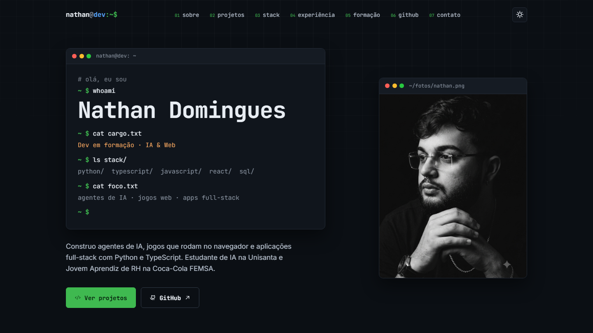

# Portfólio · Nathan Domingues

**[▶ Ver o site](https://curriculonathdomin.netlify.app)**



Portfólio pessoal com tema de terminal/IDE, em **HTML, CSS e JavaScript puros** (sem framework e sem build), publicado na **Netlify**.
Todo o conteúdo (terminal do topo, sobre, projetos, stack, experiência, formação, cursos e contato) fica em um único arquivo, [content/cv.json](content/cv.json), editável sem programar pelo painel **Decap CMS** em `/admin`.
A seção GitHub mostra ao vivo o perfil, os repositórios, as linguagens usadas e o calendário de contribuições.

O site tem versão em **inglês** (botão PT | EN no topo, ou o link [`?lang=en`](https://curriculonathdomin.netlify.app/?lang=en)), com o conteúdo em [content/cv.en.json](content/cv.en.json) e o currículo em PDF nos dois idiomas.

> 🇬🇧 *Personal portfolio with a terminal/IDE theme, in vanilla HTML/CSS/JS deployed on Netlify. All content lives in one JSON file editable through a Decap CMS admin panel; the GitHub section pulls repos, languages and the contribution calendar live.*

## Como funciona

| Parte | Arquivo |
|---|---|
| Página | [index.html](index.html) |
| Estilos e temas claro/escuro | [css/style.css](css/style.css) |
| Conteúdo (português / inglês) | [content/cv.json](content/cv.json) · [content/cv.en.json](content/cv.en.json) |
| Contato, GitHub, foto e PDFs (os dois idiomas) | [content/geral.json](content/geral.json) |
| Textos fixos da interface nos dois idiomas | [js/i18n.js](js/i18n.js) |
| Fontes dos currículos em PDF (PT e EN) | [tools/curriculo-pt.html](tools/curriculo-pt.html) · [tools/resume-en.html](tools/resume-en.html) |
| Gerar os PDFs de novo (Windows, usa o Edge) | `powershell -File tools\gerar-pdfs.ps1` |
| Montagem da página a partir do JSON + dados do GitHub | [js/render.js](js/render.js) |
| Digitação do terminal, menu, tema e animações | [js/script.js](js/script.js) |
| Painel de edição (Decap CMS + Git Gateway) | [admin/](admin/) |

Fontes externas: Google Fonts (JetBrains Mono e Inter), [Phosphor Icons](https://phosphoricons.com) e [Devicon](https://devicon.dev). O calendário de contribuições vem da API pública [github-contributions-api](https://github.com/grubersjoe/github-contributions-api).

## Rodar localmente

Qualquer servidor estático serve, por exemplo:

```bash
npx serve .
```
