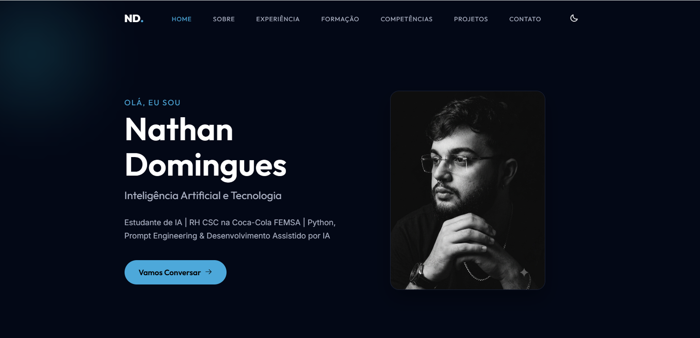

# Currículo online · Nathan Domingues

**[▶ Ver o site](https://curriculonathdomin.netlify.app)**



Currículo e portfólio pessoal em **HTML, CSS e JavaScript puro**, publicado na **Netlify**.
Todo o conteúdo (apresentação, experiência, formação, cursos, projetos e contato) fica em um único arquivo, [content/cv.json](content/cv.json), e é editável sem programar pelo painel **Decap CMS** em `/admin`.

> 🇬🇧 *Personal resume and portfolio site in vanilla HTML/CSS/JS, deployed on Netlify. All content lives in one JSON file editable through a Decap CMS admin panel.*

## Como funciona

| Parte | Arquivo |
|---|---|
| Página | [index.html](index.html) |
| Conteúdo | [content/cv.json](content/cv.json) |
| Montagem da página a partir do JSON | [js/render.js](js/render.js) |
| Interações e animações | [js/script.js](js/script.js) |
| Painel de edição (Decap CMS + Git Gateway) | [admin/](admin/) |

## Rodar localmente

Qualquer servidor estático serve, por exemplo:

```bash
npx serve .
```
